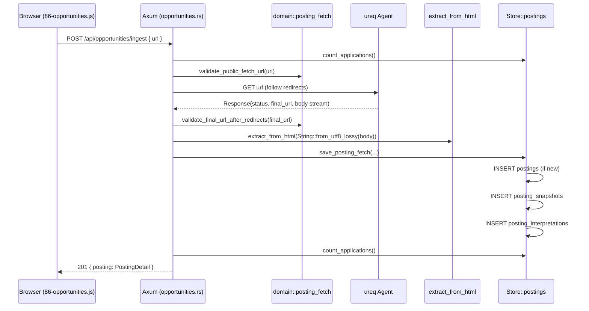

# Milestone L — Implementation Evidence and Acceptance Audit

**Subject:** Uncommitted **Opportunity Posting Ingestion** (schema **v16**)
**Audit date:** 2026-11-06 (UTC)
**Auditor role:** Repository-grounded verification (no corrective implementation in this pass).
**Scope note:** Root-level untracked planning docs (`00_*`–`09_*`, `PROPOSED_*.md`) are **out of scope** for Milestone L code review unless explicitly requested.

---

## Executive summary

The implementation delivers a working **Opportunities** slice: HTTP ingest API, SQLite persistence (`postings`, `posting_snapshots`, `posting_interpretations`), JSON-LD extraction with visible-text fallback, UI tab for fetch/list/edit/source preview, and store-level checks that **ingestion does not create `applications` rows**. **`cargo test --workspace`** and **`cargo build --workspace`** both **succeeded** (exit code **0**) at audit time.

**Gaps that block unconditional acceptance** (evidence-backed):

1. **SSRF / outbound safety** is **hostname- and literal-IP-only** before the first request; **final URL after redirects** is only re-parsed for host string safety — **no connection-level validation** of resolved addresses, **no per-redirect re-validation**, and the stored redirect “chain” is **`[request_url, final_url]`** only (not the full hop list). This matches the pre-agreed “hostname-only defense” posture but **does not demonstrate** defense against DNS rebinding or redirects to disallowed networks at connect time (**classified Blocker** for production-grade SSRF expectations; see Part D).
2. **`save_posting_fetch` is not wrapped in a SQL transaction**; a mid-flight failure after inserting a snapshot could leave an orphan snapshot without a matching interpretation (failure atomicity risk; see Part E).
3. **Automated tests** cover domain extraction and two store scenarios; they **do not** exercise live `ureq` HTTP, redirect chains, integration of PATCH interpretation, or end-to-end UI. **Manual operational demonstration was not executed** in this audit (Part F is **procedure + Unverified live claims**).

**Acceptance recommendation (Part H):** **Reject pending correction** for production-ready acceptance, primarily due to **unresolved SSRF posture** and **transaction boundaries**; the functional slice is **conditionally** usable for local research with awareness of limits.

---

## Part A — Requirement traceability

### A.1 Reconstructed requirements (accepted sources)

| ID | Requirement (concise) | Source |
|----|------------------------|--------|
| **R1** | Persist **postings**, **immutable snapshots**, and **interpretations** (machine + user JSON); schema **v16**. | `docs/MILESTONE_L_OPPORTUNITY_POSTINGS.md`, `ARCHITECTURE.md`, `crates/store/src/migrate.rs` |
| **R2** | **No `applications` row** created by ingestion; portfolio alignment (`applications.posting_id`) **deferred**. | Same + `crates/server/src/opportunities.rs` |
| **R3** | Server **HTTP fetch** with **SSRF URL checks**, **size cap**, **content-type gate**, **timeout**. | `docs/MILESTONE_L_OPPORTUNITY_POSTINGS.md`, `crates/domain/src/posting_fetch.rs`, `crates/server/src/opportunities.rs` |
| **R4** | **JSON-LD JobPosting** extraction; sensible behavior when missing/malformed. | `crates/domain/src/posting_fetch.rs` |
| **R5** | **Public API**: ingest, list, detail, snapshot source, patch interpretation (incl. optional **reviewed**). | `docs/MILESTONE_L_OPPORTUNITY_POSTINGS.md`, `crates/server/src/lib.rs` |
| **R6** | **UI**: Opportunities tab — fetch & save, list, edit interpretation, view raw snapshot. | `crates/server/static/index.html`, `crates/server/static/js/86-opportunities.js` |
| **R7** | **Current interpretation** = latest by `created_at`; **re-fetch** appends snapshot + **new** interpretation row; prior **user_json** copied forward. | `crates/store/src/postings.rs` |

### A.2 Traceability matrix

| Requirement | Implementation location | Verification method | Result | Evidence |
|-------------|---------------------------|----------------------|--------|----------|
| **R1** Schema v16: `postings`, `posting_snapshots`, `posting_interpretations` | `migrate_opportunity_postings_v16` — `crates/store/src/migrate.rs` (lines ~139–184); `schema_version` → 16 (lines ~129–135) | `cargo test -p store migrate_tests::fresh_database_schema_version_is_16 -- --nocapture` (via workspace test) | **Verified** | Test `migrate::migrate_tests::fresh_database_schema_version_is_16` passed in `cargo test --workspace` |
| **R1** Snapshot append-only | `INSERT INTO posting_snapshots` in `save_posting_fetch` — `crates/store/src/postings.rs` ~166–189 | Store test `second_fetch_appends_snapshot_keeps_history` | **Verified** | 2 snapshots, same `posting.id`, differing `body_sha256` |
| **R1** Interpretation rows linked to snapshot | `INSERT INTO posting_interpretations` — `postings.rs` ~191–200 | Code inspection + store test implies new row per fetch | **Partial** | No direct assertion on `interpretation.id` count; inferred from design |
| **R2** Ingestion does not create applications | `ingest_posting`: `count_applications` before/after — `opportunities.rs` ~107–152; store test `posting_ingest_does_not_create_application` — `postings.rs` ~492–547 | Unit test + assertion in handler | **Verified** | Test passed; handler returns 500 if counts diverge |
| **R2** No `applications.posting_id` in this increment | N/A (column not added) | Docs + migration inspection | **Verified** | `migrate_opportunity_postings_v16` creates only posting tables |
| **R3** Timeout on fetch | `ureq::AgentBuilder::timeout(domain::DEFAULT_FETCH_TIMEOUT)` — `opportunities.rs` ~34–35; `DEFAULT_FETCH_TIMEOUT` — `posting_fetch.rs` ~19 | Code inspection | **Inspected** | No automated test timing HTTP |
| **R3** Body size cap | Read loop vs `MAX_POSTING_BODY_BYTES` — `opportunities.rs` ~57–71; constant — `posting_fetch.rs` ~17 | Code inspection | **Inspected** | No unit test for boundary |
| **R3** Content-type gate | `text/html` / `application/xhtml+xml` — `opportunities.rs` ~49–55 | Code inspection | **Inspected** | No automated negative test |
| **R3** SSRF: block literal disallowed IPs / localhost host string | `validate_public_fetch_url`, `assert_host_safe`, `is_disallowed_ip` — `posting_fetch.rs` ~75–115, ~88–99 | `cargo test -p domain posting_fetch::tests::localhost_url_rejected` | **Verified** | Test passed |
| **R3** Re-check host after redirects (string) | `validate_final_url_after_redirects` — `posting_fetch.rs` ~117–124; called in `fetch_html` — `opportunities.rs` ~46–47 | Code inspection | **Inspected** | No test with real redirect to alternate host |
| **R4** JSON-LD JobPosting extraction | `extract_from_html`, `find_job_posting_value`, `merge_job_posting` — `posting_fetch.rs` ~133–303 | `posting_fetch::tests::extract_json_ld_job_posting` | **Verified** | Test passed |
| **R4** Malformed JSON-LD skipped | `extract_from_html` loop — `posting_fetch.rs` ~138–148 | Code inspection | **Inspected** | No dedicated test for malformed block |
| **R4** Visible-text fallback when no description | `visible_text_fallback` — `posting_fetch.rs` ~151–159, ~372–387 | Code inspection | **Inspected** | No unit test for fallback-only page |
| **R5** `POST /api/opportunities/ingest` | `ingest_posting` — `opportunities.rs` ~95–157; route — `lib.rs` ~220–222 | Build + code inspection | **Inspected** | No HTTP integration test in repo |
| **R5** `GET /api/opportunities`, `GET /api/opportunities/{id}` | `list_postings`, `get_posting` — `opportunities.rs` ~159–188; routes — `lib.rs` ~224–225 | Code inspection | **Inspected** | — |
| **R5** `GET /api/opportunities/snapshots/{id}/source` | `get_snapshot_source` — `opportunities.rs` ~191–211; route — `lib.rs` ~230–232 | Code inspection | **Inspected** | — |
| **R5** `PATCH .../interpretation` | `patch_posting` — `opportunities.rs` ~214–230; `update_posting_interpretation` — `postings.rs` ~387–477; route — `lib.rs` ~226–228 | Code inspection | **Inspected** | No automated test for PATCH |
| **R6** Opportunities tab + fetch UX | `index.html` panel `#panel-opportunities`; `86-opportunities.js` | Manual / browser | **Unverified** | Live UI not exercised in this audit |
| **R6** Escaping in list / meta (XSS hygiene) | `escapeHtml` for list labels; `oppMeta` uses `innerHTML` with escaped parts — `86-opportunities.js` ~94–105, ~125–126 | Code inspection | **Partial** | List/detail meta uses controlled escaping; `innerHTML` still increases risk if server strings change |
| **R7** URL dedup / normalize | `normalize_posting_url` — `postings.rs` ~14–23; uniqueness `postings.normalized_url` — `migrate.rs` ~142–147 | Store test second fetch same URL → same posting id | **Verified** | `second_fetch_appends_snapshot_keeps_history` |
| **R7** “Current” interpretation = latest `created_at` | `load_current_interpretation` `ORDER BY created_at DESC LIMIT 1` — `postings.rs` ~268–277 | Code inspection + list display uses same merge | **Inspected** | — |
| **R7** Re-fetch copies prior `user_json` | `last_user_overrides_for_posting` + insert — `postings.rs` ~191–224 | Code inspection | **Inspected** | No test asserting copy semantics |
| **R7** Review state | `reviewed_at` NULL on insert; set on `mark_reviewed` — `postings.rs` ~198, ~455–468 | Code inspection | **Inspected** | No test for review timestamp |

### A.3 Evidence index (quick links)

| Topic | Primary paths |
|------|----------------|
| HTTP ingest + fetch | `crates/server/src/opportunities.rs` |
| URL + extraction | `crates/domain/src/posting_fetch.rs` |
| Persistence | `crates/store/src/postings.rs`, `crates/store/src/migrate.rs` |
| Routes | `crates/server/src/lib.rs` (~220–232) |
| UI | `crates/server/static/js/86-opportunities.js`, `crates/server/static/index.html` |
| Docs | `docs/MILESTONE_L_OPPORTUNITY_POSTINGS.md`, `ARCHITECTURE.md`, `JOBDESK.md` |

---

## Part B — Explain the implementation

### B.1 End-to-end flow (numbered to match audit prompt)

1. **URL ingestion UI event and HTTP request**
   **Owner:** browser script `86-opportunities.js`. User clicks **Fetch & save** → `fetch("/api/opportunities/ingest", { method: "POST", body: JSON.stringify({ url }) })` (lines ~157–172).

2. **Server request handling**
   **Owner:** Axum router in `crates/server/src/lib.rs` routes to `opportunities::ingest_posting`. Handler checks `db_path.exists()`, counts applications, then runs sync fetch logic (lines ~95–157 in `opportunities.rs`).

3. **URL validation and HTTP retrieval**
   **Owner:** `fetch_html` in `opportunities.rs` calls `validate_public_fetch_url` (`posting_fetch.rs`) before `ureq::Agent` GET. Timeout, redirect limit 15, user-agent set on builder (lines ~32–43).

4. **Redirect handling and network security enforcement**
   **Owner:** `ureq` follows redirects automatically (`redirects(15)`). After response, `final_url = resp.get_url()` and **`validate_final_url_after_redirects(&final_url)`** re-parses host string only (`opportunities.rs` ~46–47). **No** per-hop validation; **no** socket-level IP check.

5. **HTML/JSON-LD extraction and fallback**
   **Owner:** `domain::extract_from_html` (`posting_fetch.rs` ~133–168): scans `application/ld+json` scripts, finds first `JobPosting`, merges fields; if `description_plain` still empty, **`visible_text_fallback`** (strip tags, require ≥80 chars of body text).

6. **Domain validation and data transformation**
   **Owner:** `extract_from_html` + `FetchedPostingPayload`. On **PATCH**, `update_posting_interpretation` validates merged payload via `validate_compensation`, `validate_application_meta` (`postings.rs` ~435–453).

7. **Database transaction boundaries**
   **Owner:** `Store::save_posting_fetch` uses **`conn.execute` sequentially without `BEGIN`/`COMMIT`** (`postings.rs` ~150–207). **Single connection** (typical SQLite) but **not an atomic transaction** for multi-statement ingest.

8. **Creation and re-fetch behavior for postings**
   **Owner:** `save_posting_fetch`: upsert posting by **normalized final URL**; always **INSERT** new snapshot; **INSERT** new interpretation (`postings.rs` ~150–209). Second fetch with same normalized URL reuses `posting_id` (store test verifies two snapshots).

9. **Snapshot immutability**
   **Owner:** application code — **no UPDATE** on `posting_snapshots` in reviewed code path; only INSERT. **DB:** no `UPDATE` trigger preventing mutation (see B.4).

10. **Creation and updating of interpretations**
   **Owner:** new row per ingest; **PATCH** updates **latest** interpretation’s `user_json` / `reviewed_at` only (`postings.rs` ~387–477).

11. **Reviewed versus unreviewed state**
   **Owner:** `reviewed_at` column; NULL until `mark_reviewed: true` on PATCH (`postings.rs` ~455–468). UI shows line from `current.reviewed_at` (`86-opportunities.js` ~47–51).

12. **UI retrieval, editing, and source display**
   **Owner:** GET list/detail; GET snapshot source as `text/plain`; form fields PATCH `user_overrides` (`86-opportunities.js` ~114–142, ~195–253). Source shown in `<pre>` via **`textContent`** (safe for HTML).

13. **Error and failure propagation**
   **Owner:** `PostingFetchError` → 400 JSON `{ "error": ... }` (`opportunities.rs` ~81–85, ~112–116); store errors → `anyhow_response` (400). Ingest guard: **500** if application count changes (~145–151).

### B.2 Mermaid sequence diagram (actual call flow)

### B.3 Tables, “current” interpretation, constraints

- **`postings`**: one row per **deduplicated** opportunity (`normalized_url` **UNIQUE** — `migrate.rs` ~142–147).
- **`posting_snapshots`**: many per posting; `FOREIGN KEY posting_id REFERENCES postings(id) ON DELETE CASCADE`; **no FK from postings “current” pointer** — “current” is computed in SQL.
- **`posting_interpretations`**: many per posting; FK to `postings` and `posting_snapshots` **ON DELETE CASCADE** (`migrate.rs` ~169–177).

**Current interpretation selection:** `ORDER BY created_at DESC LIMIT 1` on `posting_interpretations` (`postings.rs` ~268–277, ~393–401). **Display merge:** `merge_payload(machine_suggested, user_overrides)` (`postings.rs` ~91–108).

**SQLite:** Project **`Store::open`** does not enable `PRAGMA foreign_keys = ON` in reviewed code; **foreign key enforcement may be off** unless SQLite is built with non-default settings (integrity risk — **Inspected** as potential app-only invariant).

### B.4 Invariants enforced in application code vs database

| Invariant | Enforcement |
|-----------|-------------|
| Snapshot row not updated in normal flow | **Application** (no UPDATE path observed) |
| One posting per normalized URL | **DB** — `UNIQUE(normalized_url)` |
| Interpretation references valid snapshot/posting | **DB** — FK definitions (if FK enabled) |
| Ingest does not create applications | **Application** — count check + store test |
| Body size cap before persist | **Application** — read loop in `fetch_html` |
| “Latest” interpretation | **Application** — query `ORDER BY created_at DESC` (no constraint that only one row is “current”) |

---

## Part C — Test evidence

### C.1 Commands executed (audit machine)

| Command | Exit status | Notes |
|---------|-------------|-------|
| `cargo test --workspace` | **0** | All listed packages’ unit/integration tests passed |
| `cargo build --workspace` | **0** | Release profile: `dev` (debug) default; full workspace compiled |

### C.2 Summary counts (from `cargo test --workspace` output)

- **domain:** 31 passed
- **jobdesk:** 3 + 3 + 2 = 8 passed (lib + `lifecycle_cli` + `mcp_protocol`)
- **onet_import:** 5 passed
- **render_tex:** 3 passed
- **resolve:** 7 passed
- **server:** 2 passed
- **similarity:** 1 passed
- **store:** 10 passed (includes **`fresh_database_schema_version_is_16`**, **`posting_ingest_does_not_create_application`**, **`second_fetch_appends_snapshot_keeps_history`**)
- **render_pdf:** 0 tests
- **Doc-tests:** 0 across crates

**Total runnable tests observed:** **67 passed**, **0 failed**, **0 ignored** (per output).

### C.3 Scenario checklist vs evidence

| Scenario | Automated test / run | Result |
|----------|---------------------|--------|
| Successful JSON-LD extraction | `domain::posting_fetch::tests::extract_json_ld_job_posting` | **Verified** |
| Missing or malformed JSON-LD | No dedicated test | **Unverified** (diagnostics path **Inspected**) |
| Conventional HTML fallback | No dedicated test; requires ≥80 chars visible text | **Unverified** |
| Missing employer/title/location/salary | Partially covered by default/optional fields in extraction test | **Partial** |
| Malformed URLs / unsupported schemes | `localhost_url_rejected`; unsupported scheme path not explicitly tested | **Partial** |
| HTTP failures | Not unit-tested (would need mock server) | **Unverified** |
| Redirects | Not tested | **Unverified** |
| Response-body limits | Not unit-tested | **Unverified** (logic **Inspected**) |
| Duplicate URL / same posting | `second_fetch_appends_snapshot_keeps_history` | **Verified** |
| Re-fetch / preserve earlier snapshots | Same test | **Verified** |
| Persistence of unreviewed posting (`reviewed_at` NULL) | No assertion | **Inspected** |
| Edit + mark reviewed | No API/HTTP test | **Unverified** |
| Re-fetch after manual corrections | No test (user_json copy behavior **Inspected**) | **Unverified** |
| Reload saved postings (durability) | No restart/integration test | **Unverified** |
| Zero application creation on ingest | `posting_ingest_does_not_create_application` | **Verified** |

**Skipped / warnings:** None reported in the captured `cargo test --workspace` output.

### C.4 Isolated DB + HTTP fixtures

**Not executed** in this audit (no temporary workspace server run, no local mock HTTP fixture harness). Gaps noted above remain.

---

## Part D — Security audit

### D.1 SSRF and outbound requests

| Check | Finding | Severity |
|-------|---------|----------|
| Literal private/loopback IPs in URL | **Rejected** in `assert_host_safe` when host parses as `IpAddr` (`posting_fetch.rs` ~93–98, `is_disallowed_ip` ~102–114). IPv6 loopback / unique local included for literal IPs. | Low (for literal form only) |
| Hostname resolving to private IP | **Not validated at connection time.** A “public” hostname may resolve to **10.x** etc. | **High** |
| DNS rebinding / TOCTOU | Initial host string check **does not** compare to actual socket peer address after connect. | **High** |
| Redirects to forbidden destination | **After** redirects, only **`validate_final_url_after_redirects`** on **final URL string**. Intermediate hops not checked; **no** IP binding check. **`ureq`** may follow to a different host than the pre-request string. | **High** |
| Automatic redirects bypass validation | First hop validated by string; **subsequent hop host** could be disallowed if expressed as IP in final URL — **Partial**; still no connect-time check. | **Medium** |
| URL encoding / alternative IP forms | Hostname path not canonicalized beyond `Url::parse`; IDNA/casing — rely on `url` crate. Octal IPv4 etc. not specifically tested. | **Medium** (uncertainty) |
| Timeouts | **10s** `DEFAULT_FETCH_TIMEOUT` (`posting_fetch.rs` ~19). | **Low** (DoS-ish risk bounded) |
| Body limits | **2_000_000** bytes max read (`MAX_POSTING_BODY_BYTES`). | **Low** |
| Decompression / gzip bomb | **Not** explicitly audited in `ureq` usage; depends on crate defaults. | **Medium** (unverified) |
| Content-type | Non-HTML rejected before read completes typing check on header; body still read up to cap. | **Low** |

**Finding D-SSRF-1 (Blocker for production SSRF bar):** **Hostname-only** validation does **not** demonstrate **connection-level** SSRF defense. Redirect and DNS rebinding scenarios are **not** mitigated by evidence in this codebase. **Reproducibility:** design-level; safe live PoC against real malicious infra was **not** run (per audit constraints).

### D.2 Untrusted content (XSS)

| Surface | Behavior | Risk |
|---------|----------|------|
| Raw HTML snapshot | Served as **`text/plain`** (`opportunities.rs` ~202–207); UI uses **`textContent`** (`86-opportunities.js` ~135). | **Low** (not interpreted as HTML in UI) |
| Extracted / merged fields in form | `.value` / `textContent` assignments | **Low** |
| List + meta line | **`innerHTML`** with **`escapeHtml`** for dynamic strings (`86-opportunities.js` ~94–105, ~125–126). | **Medium** if escaping contract breaks or future unescaped concat |
| Error strings from API | Shown via `textContent` (`oppStatus`, `oppMeta` in error branches) | **Low** |

**Finding D-XSS-1 (Medium):** Reliance on **`innerHTML`** + manual escaping is **fragile** compared to `textContent`-only or DOM APIs; current paths escape user/server strings for the main dynamic parts **Inspected** as intentional.

### D.3 Persistence and data integrity

| Topic | Assessment |
|-------|------------|
| SQL parameterization | **Yes** — `params![]` / `?1` placeholders throughout `postings.rs` |
| JSON validation on PATCH | Merged payload validated; machine JSON parsed with `serde` |
| Transaction boundaries | **`save_posting_fetch` not atomic** — risk of partial insert (Finding D-TXN-1, **High** integrity) |
| Rollback on failed re-fetch | Ingest path: if `save_posting_fetch` fails after network success, **no** partial DB state from handler (single call); **inside** `save_posting_fetch`, partial failure possible |
| FK enforcement | **Not verified** — recommend **`PRAGMA foreign_keys=ON`** for `Store::open` |

---

## Part E — Adversarial correctness review

| # | Question | Safeguard / test / gap |
|---|----------|-------------------------|
| 1 | **Re-fetch after review** supersede reviewed interpretation? | New **interpretation** row becomes **current** (`ORDER BY created_at DESC`). **`reviewed_at` is NOT copied** to the new row (insert has `NULL` — `postings.rs` ~198). **Prior reviewed row remains in DB** but UI shows **unreviewed** latest. **Gap:** UX does not surface “you had reviewed an older version.” **Unresolved** product semantics. |
| 2 | **Copied `user_json`** misleading after employer changes posting? | **Confirmed behavior:** prior `user_json` copied into new interpretation (`postings.rs` ~191–194). **Risk:** stale overrides overlay new machine extract. **No** test. **Unresolved**. |
| 3 | **Snapshot immutability** via all APIs? | No update API for snapshots **Inspected**. **Exposed risk:** direct SQL or future code could UPDATE. **Partial**. |
| 4 | **Deduplication** merge unrelated URLs? | **Normalization** strips fragment, http→https, trailing slash (`normalize_posting_url`). Could merge URLs that differ only by those (often intended). **Edge cases** (trailing path variants, tracking params) **Unverified**. |
| 5 | **Application isolation** | **Verified** (test) no new application on ingest; handler **500** if counts change. |
| 6 | **Incomplete extraction / boilerplate as description** | **visible_text_fallback** can include nav/legal if long enough (**≥80 chars**). **Unresolved** quality risk. |
| 7 | **Failure atomicity** | **No transaction** wrapping posting+snapshot+interpretation. **Orphan snapshot** possible on failure between inserts. **Unresolved**. |
| 8 | **Review semantics** | **`reviewed_at`** applies to **current latest row only** when marking reviewed. **Does not** fingerprint snapshot/hash/version. **Partial** / **Unresolved** for audit trail strength. |

---

## Part F — Operational acceptance demonstration

**Status:** **Not executed** in this audit (no live server started, no temp workspace DB file exercised against real URLs). The following is a **reproducible procedure** for the owner to run in isolation.

### F.1 Prerequisites

- Build: `cargo build -p jobdesk` (or workspace).
- Use a **fresh** workspace directory and **empty** or **dedicated** `jobdesk.db` path (not the owner’s production catalog with PII).

### F.2 Suggested steps (curl + sqlite)

1. **Initial DB / application count:** `sqlite3 /path/to/jobdesk.db "SELECT COUNT(*) FROM applications;"`
2. **Start serve** (per `JOBDESK.md` patterns) pointing at that DB.
3. **Ingest:** `curl -s -X POST http://127.0.0.1:<port>/api/opportunities/ingest -H 'Content-Type: application/json' -d '{"url":"https://example.com/..."}'`
4. **Inspect opportunity:** `GET /api/opportunities` and `GET /api/opportunities/{id}`
5. **Source:** `GET /api/opportunities/snapshots/{snapshot_id}/source`
6. **Edit:** `PATCH /api/opportunities/{id}/interpretation` with `user_overrides`
7. **Restart** server; re-GET detail (**Unverified** here)
8. **Re-fetch:** POST ingest same URL again; verify **two** snapshots via GET detail
9. **SQL:** `SELECT COUNT(*) FROM posting_snapshots WHERE posting_id='...';`
10. **Applications unchanged:** `SELECT COUNT(*) FROM applications;` same as step 1

**Live vs fixture:** Automated tests used **synthetic HTML strings** (fixture-like), **not** live sites.

---

## Part G — Change inventory and architectural assessment

### G.1 `git status --short` (snapshot at audit)

Modified tracked files included: `ARCHITECTURE.md`, `Cargo.toml`, `Cargo.lock`, `JOBDESK.md`, `crates/domain/Cargo.toml`, `crates/domain/src/lib.rs`, `crates/server/*`, `crates/store/*`, static assets, etc.

**Untracked (Milestone L–relevant):**

- `crates/domain/src/posting_fetch.rs`
- `crates/server/src/opportunities.rs`
- `crates/server/static/js/86-opportunities.js`
- `crates/store/src/postings.rs`
- `docs/MILESTONE_L_OPPORTUNITY_POSTINGS.md`

**Untracked (out of scope unless needed):** `00_*.md` … `09_*.md`, `PROPOSED_*.md`.

### G.2 `git diff --stat` (truncated headline)

~732 insertions across 15 tracked files per `git diff --stat` (full stat in shell at audit time).

### G.3 Schema and migrations

- **`migrate_opportunity_postings_v16`** adds `postings`, `posting_snapshots`, `posting_interpretations` + indexes; **`schema_version` = 16** (`migrate.rs`).

### G.4 New dependencies

- **Workspace:** `ureq`, `url` (`Cargo.toml`).
- **server:** `ureq` for blocking HTTP.
- **domain:** `url` for parsing/validation.
- **store:** `url` for posting URL normalization.

### G.5 Public API additions

REST endpoints under `/api/opportunities/*` (`lib.rs`).

### G.6 Architectural notes

- **Layering:** Domain holds **pure** extraction + URL validation; **store** owns persistence; **server** orchestrates fetch + HTTP. Coherent.
- **Blocking HTTP inside async handler:** `ingest_posting` runs **`fetch_html`** synchronously — acceptable at MVP but can **block** the async worker thread under load (**Medium** operational concern).
- **Duplication:** Redirect “chain” stored as synthetic two-element vector (`opportunities.rs` ~77) vs real hop list — **documentation gap** more than code duplication.

---

## Part H — Final evidence-based verdict

### H.1 Requirements satisfied (evidence-backed)

- Schema **v16** tables and migration (**test**).
- **JSON-LD** extraction happy path (**test**).
- **Literal** dangerous URL hosts rejected (**test**).
- **Postings** persistence with **second fetch** = second snapshot, same posting (**test**).
- **Ingest does not create applications** (**test** + handler guard **Inspected**).
- **Workspace build** succeeds (**command**).

### H.2 Partially satisfied or unverified

- Full **HTTP** behavior (status errors, redirects, TLS edge cases).
- **PATCH** interpretation and **mark reviewed** end-to-end.
- **UI** E2E and **restart durability** demo.
- **Fallback** description quality and **malformed JSON-LD** edge cases.
- **Foreign keys** enforcement in SQLite connection.
- **Transactional** atomicity of ingest writes.

### H.3 Confirmed defects

None **reproduced** as failing tests in this audit. **Design-level issues** (SSRF depth, non-atomic ingest) are **findings**, not CI failures.

### H.4 Architectural concerns

- Blocking **ureq** in async Axum handler.
- **“Current interpretation”** without version linkage to **reviewed** state or **snapshot** identity.
- Possible **orphan rows** without a wrapping transaction.

### H.5 Security findings

| ID | Finding | Severity |
|----|---------|----------|
| D-SSRF-1 | No connection-level SSRF defense; hostname-only + final URL string check | **Blocker** (vs stated production bar) |
| D-TXN-1 | Multi-row ingest without SQL transaction | **High** (integrity) |
| D-FK-1 | FK constraints may not be enforced if `foreign_keys` off | **Medium** |
| D-XSS-1 | `innerHTML` + manual escape for meta/list | **Medium** |
| — | Decompression / redirect hop validation unverified | **Medium** |

### H.6 Proposed corrective actions (minimal, prioritized)

1. **SSRF:** After connect (or use a custom connector), **assert** peer IP is globally routable; **re-validate** URL/host **each redirect hop**; optional **allowlist** of hosts for MVP.
2. **Transactions:** Wrap `save_posting_fetch` inserts in **`BEGIN IMMEDIATE`** … **`COMMIT`** with rollback on error.
3. **SQLite:** `PRAGMA foreign_keys = ON` on `Store::open`.
4. **Tests:** HTTP integration tests with **local mock server** (redirects, 404, non-HTML, oversized body).
5. **UX/Data:** On new interpretation after review, surface **review status** across versions or tie **reviewed** to **(snapshot_id, user_json hash)**.
6. **UI:** Prefer **`textContent`** / `createTextNode` over **`innerHTML`** for dynamic strings.

### H.7 Acceptance recommendation

**Reject pending correction:** Mandatory **network-ingestion security** and **transactional integrity** properties are **not** evidenced at the level this audit requires; **hostname-only SSRF** remains an **acknowledged gap**, not a resolved control.

---

## Audit constraints (this document)

- **No** source files, migrations, or tests were modified to produce this report.
- **No** git **commit** or **push** was performed for this audit.
- **No** live posting URL was fetched against the auditor’s environment for Part F.

---

*End of report.*
