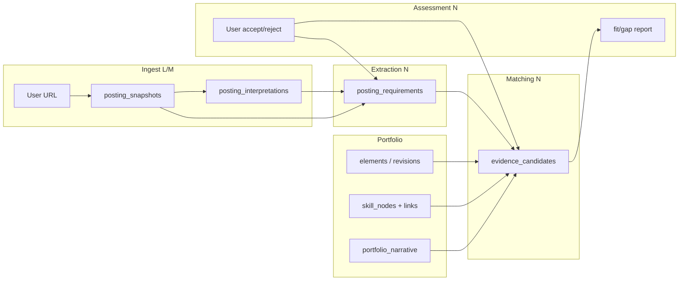

# Next milestone discovery — posting requirements & portfolio evidence

**Date:** 2026-11-12  
**Scope:** Read-only architecture review after Milestones L/M acceptance. **No implementation authorized.**

---

## 1. Git publication status

| Step | Result |
|------|--------|
| `git fetch origin` | OK |
| `git merge-base --is-ancestor origin/master HEAD` | **Yes** (clean fast-forward) |
| `git log --oneline origin/master..HEAD` | 3 commits (see below) |
| Working tree | Tracked files clean; untracked drafts + `milestone-m-review-final.patch` only |
| `git push origin master` | **Blocked** — `fatal: could not read Username for 'http://192.168.50.18:3000'` |

**Outgoing commits (unpublished):**

```
a9685c2 feat(opportunities): add Greenhouse API adapter and source-aware ingestion  (M)
ce6a3c2 feat(opportunities): add independent posting capture and browser acceptance (L)
97fb46d feat(portfolio): optional project portfolio_narrative for long-form Markdown
```

**Owner action:** From an authenticated environment:

```bash
git push origin master
```

Then verify: `git rev-parse HEAD` equals `git rev-parse origin/master`.

`origin` remote: `http://192.168.50.18:3000/epsil0n/resume.git` (Forgejo). `github` remote exists but was **not** pushed per assignment constraints.

---

## 2. Verified inventory (implemented code & schema)

### 2.1 Portfolio catalog

| Concept | Implementation |
|---------|----------------|
| **Element kinds** | `header`, `objective`, `experience`, `education`, `project`, `course`, `certification`, `award` — `domain::ElementKind` in `crates/domain/src/lib.rs` |
| **Storage** | `elements`, `element_revisions` (append-only `payload_json`) — `crates/store/src/migrate.rs`, `crates/store/src/catalog.rs` |
| **`portfolio_narrative`** | Optional string on **project** payloads only; validated in `crates/domain/src/validation.rs`; preserved in YAML export/import (`crates/store/src/export.rs`); **stripped** on PDF resolve (`crates/resolve/src/lib.rs`, tests in `crates/resolve/src/tests.rs`); **not** in LaTeX output (`crates/render_tex`) |
| **Revision history** | `element_revisions.rev_number`; new revision on edit (import policy in `crates/store/src/import.rs`) |

### 2.2 Skills, evidence links, competency graph

| Table / API | Role | Files |
|-------------|------|--------|
| `skill_nodes` | Tools, competencies, tags; `aliases_json`, `framework_refs_json` | `crates/store/src/migrate.rs`, `crates/store/src/skills.rs` |
| `revision_skill_links` | Per-revision asserted skills (`source` = `asserted`) | Same |
| `element_skill_links` | Element-level asserted skills | v10 migration |
| `tool_competency_edges` | Tool→competency graph (import/O*NET) | Same |
| **Query surfaces** | `get_element_skill_links`, `all_asserted_skill_ids`, `skill_ids_on_composition` | `crates/store/src/skills.rs` |

**Evidence model today:** Assertions are **skill-id links** on catalog elements/revisions, not free-text “evidence records” with citations.

### 2.3 Opportunity postings (L/M)

| Table | Purpose | Key fields |
|-------|---------|------------|
| `postings` | Saved opportunity by normalized URL | `id`, `user_state`, timestamps |
| `posting_snapshots` | Immutable fetch bodies | `raw_body_html`, `body_sha256`, `retrieval_kind`, `provider_provenance_json`, diagnostics |
| `posting_interpretations` | Per-snapshot machine + user JSON | `machine_json`, `user_json`, `reviewed_at` |
| `posting_fetch_attempts` (v17) | Every fetch, including failures | `outcome`, `http_status`, optional `snapshot_id` |

**Store:** `crates/store/src/postings.rs`  
**HTTP:** `crates/server/src/opportunities.rs`, `crates/server/src/greenhouse_ingest.rs`  
**Domain extractors:** `crates/domain/src/posting_fetch.rs`, `crates/domain/src/greenhouse*.rs`

**No `applications.posting_id`** — explicitly deferred in `ARCHITECTURE.md`. Opportunities and applications are **disjoint** tables.

### 2.4 Applications & lifecycle

| Table | Fields (relevant) | Files |
|-------|-------------------|--------|
| `applications` | `posting_url`, **`posting_text`** (manual paste), `draft_composition_json`, phase/status, meta | `crates/store/src/applications.rs`, migrate |
| `submissions` | Immutable manifests + PDF artifacts | `crates/store/src/applications.rs` |
| `presets` | Saved compositions without posting | `crates/store/src/presets.rs` |

**Lifecycle:** `domain::application_lifecycle` — phase/workflow coercion and validation.

### 2.5 Existing “matching” / analyze (application-scoped)

| Capability | What it does | Boundary |
|------------|--------------|----------|
| **`posting_hints`** | Substring match of skill catalog terms in **posting text** vs skills on **draft composition** | `crates/domain/src/posting_hints.rs`, `store::application_posting_hints` |
| **`application_analyze`** | Builds `ApplicationAnalyzeReport`: skill gap/partial/evidenced/extra, composition gaps (pinned elements with overlap not on draft), heuristic objective/title warning | `crates/domain/src/application_analyze.rs`, `store::application_analyze` |
| **Similarity** | Jaccard on **draft composition** element ids + tags + title between **applications** | `crates/similarity/src/lib.rs` |

**Inputs for analyze today:** `ApplicationDetail.posting_text` (or fallback title/company/tags), **not** Opportunities `PostingDetail`. Composition is always a **résumé draft**, not the full catalog.

**HTTP:** `GET /api/applications/{id}/analyze`, `GET .../posting-hints`, `POST .../posting-hints/preview` — `crates/server/src/applications.rs`  
**CLI:** `jobdesk analyze <id>` — `crates/jobdesk/src/main.rs`  
**MCP:** `posting_hints`, `analyze` (application id) — `crates/jobdesk/src/mcp_tools.rs`

### 2.6 Crate boundaries (current)

| Crate | Responsibility |
|-------|----------------|
| `domain` | Pure logic: validation, posting fetch/extract, hints, analyze report builder, lifecycle |
| `store` | SQLite, migrations, all persistence |
| `server` | HTTP UI + APIs |
| `resolve` / `render_tex` / `render_pdf` | Manifest → PDF (portfolio narrative stripped) |
| `jobdesk` | CLI + MCP stdio |
| `similarity` | Application-to-application ranking |
| `onet_import` | Skill graph seed (orthogonal) |

**Schema version:** 17 (`posting_fetch_attempts`, snapshot provenance columns) — `crates/store/src/migrate.rs`, test `migrate_fresh_database_schema_version_is_17`.

### 2.7 Documented but not implemented (relevant)

From `ARCHITECTURE.md` and Milestone M spec:

- `applications.posting_id` / “start application from posting” — **not built**
- Portfolio-wide analyze from **saved postings** — **not built** (M spec explicitly out of scope)
- Structured **requirement** entities, passage citations, evidence match rows — **no tables**
- LLM requirement extraction — **no production path** (MCP warns about external LLM for catalog payloads only)

---

## 3. Architectural strengths

1. **Clear separation:** Opportunities (research) vs applications (tracked candidacies) without accidental coupling (L/M ingest does not create applications).
2. **Immutable snapshots + interpretation history** with user review and stale-edit protection — good anchor for traceability.
3. **Rich portfolio model:** kinds, revisions, skill assertions, optional `portfolio_narrative` for depth beyond résumé bullets.
4. **Deterministic analyze pipeline** already encodes gap vs partial vs evidenced at **skill** granularity with explainable `matched_phrase` and composition gap reasons.
5. **Local-first:** MCP tools expose catalog and evidence links without cloud dependency.

---

## 4. Gaps vs target capability

Target: *Given a saved job posting, extract employer requirements, match **entire portfolio** evidence, distinguish missing evidence vs lack of skill, user-correctable, actionable fit/gap report.*

| Need | Status |
|------|--------|
| Individual **requirement** with source passage | **Missing** — only full `description_plain` / machine JSON fields |
| Mandatory vs preferred vs ambiguous | **Missing** |
| Link requirement → snapshot id + text span / offset | **Missing** |
| Portfolio-wide scan (not draft composition) | **Missing** — analyze uses `draft_composition` + hints |
| Evidence claim citing **element + revision + narrative excerpt** | **Partial** — skill links + `portfolio_narrative` exist but no requirement bridge |
| Evidence context (professional vs personal vs academic) | **Implicit** via `element.kind` only; not in analyze |
| Confidence / uncertainty without arbitrary scores | **Partial** — `SkillAlignmentStatus` enum only; no requirement-level uncertainty |
| Missing evidence vs demonstrated lack of capability | **Not modeled** — `Gap` conflates “not on draft” and “not in catalog” |
| User corrections to requirements/matches | **Pattern exists** for interpretations (`user_json`); not for requirements |
| Opportunities API analyze endpoint | **Missing** |

---

## 5. Extraction vs matching vs assessment (recommended separation)

| Operation | Persist? | Rationale |
|-----------|----------|-----------|
| **Extraction** | Yes, versioned per interpretation | Employer-facing claims must cite `snapshot_id` + stable passage id; re-run when interpretation or snapshot changes |
| **Matching** | Yes, derived rows | Recomputable from extraction + catalog snapshot, but users may **pin/dismiss** matches |
| **Assessment** | Yes, derived + reviewable | Fit/gap summary and per-requirement status; must survive re-analysis with explicit supersession |

**Traceability rule:** No row labeled “employer requirement” without `source_snapshot_id` and `source_span` (or equivalent quote hash). Inferred soft skills stay in a separate `inference` or `suggestion` type.

**Anti-patterns to avoid (called out in assignment):**

- Treating skill substring match as proof of competence (today’s `posting_hints` is a **hint** layer only).
- Treating absent portfolio evidence as proof user lacks skill.
- Presenting LLM output as employer text without review gate.

---

## 6. Recommended minimal vertical slice (Milestone N proposal — design only)

**Goal:** One **reviewed** opportunity posting → requirement list → portfolio evidence candidates → explainable fit/gap report. **Full catalog**, default composition = empty or “include all for search only.”

### 6.1 Workflow (user-visible)

1. User marks opportunity interpretation **reviewed** (existing).
2. **Extract requirements** (deterministic first: section-aware bullets from `description_plain` + headings; optional LLM assist behind feature flag with mandatory review).
3. User edits requirement text, type (must/nice/unclear), deletes false positives.
4. **Match portfolio:** for each requirement, search:
   - All `element_revisions` latest payload text
   - `portfolio_narrative` on projects
   - Asserted `skill_nodes` via `element_skill_links` / `revision_skill_links` (with `matched_phrase` style explanation)
5. User accepts/rejects proposed links.
6. **Report:** unresolved requirements, requirements with evidence, requirements with catalog skill but no narrative, explicit “no evidence found” (not “cannot do”).

### 6.2 Suggested persistence (sketch — not implemented)

- `posting_requirements` — `interpretation_id` FK, `ordinal`, `text`, `kind`, `source_quote`, `source_snapshot_id`, `user_edited` flag
- `requirement_evidence_candidates` — `requirement_id`, `element_id`, optional `revision_id`, `match_kind` (`skill_assertion` \| `text_excerpt` \| `narrative`), `explanation`, `status` (`proposed` \| `accepted` \| `rejected`)
- `posting_fit_reports` — optional snapshot of summary JSON at review time

**Anchor choice (owner decision):** requirements tied to **`interpretation_id`** (reviewed worldview), not raw snapshot — snapshot cited inside each requirement for provenance.

### 6.3 Reuse existing code

- Text normalization / tokenization: `posting_hints.rs`
- Skill matching: `match_skills_in_posting`, `build_posting_hints` — widen input to full-catalog skill set without draft filter
- Status taxonomy: extend `SkillAlignmentStatus` or parallel `RequirementCoverageStatus` with explicit **NoEvidenceInPortfolio** vs **NotAssessedForCapability**
- Store patterns: mirror `posting_interpretations` user_json merge for corrections

### 6.4 LLM (if used)

- **Only** after snapshot is stored; input = archived `description_plain` + optional HTML excerpt; output = draft requirement list with quotes.
- Persist as **unreviewed** machine rows; UI gate before “employer requirement” label.
- No silent network dependency in CI; local/manual acceptance only.

---

## 7. Proposed data flow



| Component | Responsibility |
|-----------|----------------|
| `domain` | Requirement parsing types, coverage enum, report builder (pure) |
| `store` | New tables + queries; no change to snapshot immutability |
| `server` | Opportunities tab: Extract / Match / Report; reuse posting detail |
| `jobdesk` MCP | Optional tools: `get_posting_requirements`, `analyze_posting_portfolio` |

---

## 8. Owner decisions required

1. **Requirement anchor:** per `interpretation_id` (recommended) vs per `snapshot_id` vs per `posting_id` rolling “current”.
2. **Evidence records:** first-class `evidence_candidates` table vs ephemeral report JSON only for v1.
3. **Strength language:** enumerated statuses + short explanations (recommended) vs numeric scores (defer).
4. **Re-analysis:** supersede prior requirement rows vs append-only with `supersedes_id`.
5. **LLM:** rule-only v1 vs optional assist from day one (with review gate).
6. **Application bridge:** when to add `applications.posting_id` and whether analyze migrates from pasted `posting_text` to linked posting.
7. **Reproducibility:** reports must be regeneratable from DB + snapshot bytes (align with `body_sha256` contract).

---

## 9. Non-goals (next milestone)

- Multi-ATS ingestion, portfolio merge across employers, auto-apply
- Replacing skill catalog with external ontology
- Autonomous “you cannot do this job” conclusions
- Résumé composition auto-rewrite from requirements (separate milestone)
- Committing this discovery doc or implementing schema changes without a follow-on authorization

---

## 10. Implementation risks

| Risk | Mitigation |
|------|------------|
| Conflating keyword match with competence | Separate `hint` from `evidence`; user acceptance required for claims |
| Requirement drift when user re-fetches posting | Bind requirements to interpretation + snapshot quote; invalidate on new interpretation |
| `portfolio_narrative` size / PII in MCP | Size limits (existing MCP caps); evidence excerpts not full dump |
| LLM hallucinated requirements | Quote-required schema; must match source substring or flagged |
| Duplicating `application_analyze` | Shared domain helpers; different input adapter for `PostingDetail` |

---

## 11. Key file references (quick index)

| Topic | Path |
|-------|------|
| Posting schema & API | `crates/store/src/postings.rs`, `crates/server/src/opportunities.rs` |
| Application analyze | `crates/domain/src/application_analyze.rs`, `crates/store/src/applications.rs` |
| Skill / hint matching | `crates/domain/src/posting_hints.rs`, `crates/store/src/skills.rs` |
| Migrations | `crates/store/src/migrate.rs` |
| Element kinds / validation | `crates/domain/src/lib.rs`, `crates/domain/src/validation.rs` |
| Architecture checklist | `ARCHITECTURE.md` |
| M out-of-scope statement | `docs/MILESTONE_M_GREENHOUSE_ADAPTER_SPEC.md` |

---

**Status:** Discovery complete. **Not committed** (awaiting separate authorization). Publication of L/M commits remains **blocked on Forgejo credentials** — run `git push origin master` locally.
